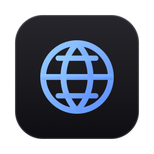
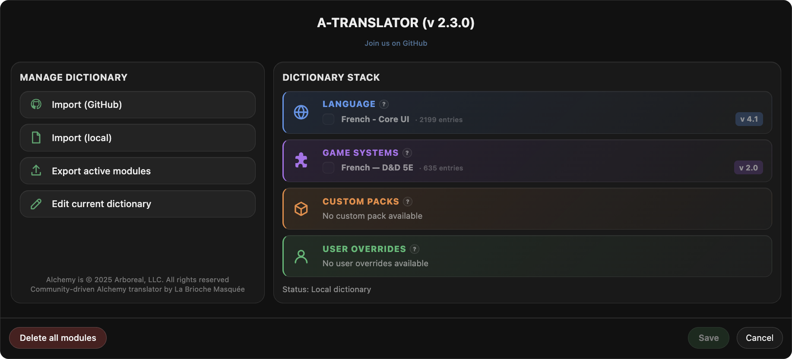

<div align="center">
  

  # A-Translator

  Nieoficjalne narzędzie do lokalizacji tworzone przez społeczność dla [Alchemy VTT](https://alchemyrpg.com)

  
  
  
  

  🇬🇧 [English](README.md) · 🇫🇷 [Français](README.fr.md) · 🇪🇸 [Español](README.es.md) · 🇳🇱 [Nederlands](README.nl.md) · **🇵🇱 Polski** · 🇧🇷 [Português (Brasil)](README.pt-br.md)
</div>

> [!NOTE]
> A-Translator to nieoficjalny projekt społeczności. Nie jest powiązany z Arboreal, LLC. Wszystko dzieje się lokalnie w Twojej przeglądarce: słowniki są przechowywane na Twoim komputerze, a **żadne dane nie są nigdzie wysyłane**.

## Spis treści

- [Czym jest A-Translator](#czym-jest-a-translator)
- [Czym A-Translator nie jest](#czym-a-translator-nie-jest)
- [Instalacja](#instalacja)
- [Aplikacja desktopowa Alchemy (macOS)](#aplikacja-desktopowa-alchemy-macos)
- [Użycie](#użycie)
- [Dostępne słowniki](#dostępne-słowniki)
- [Typy i format słowników](#typy-i-format-słowników)
- [Aktualizacje](#aktualizacje)
- [Współtworzenie](#współtworzenie)
- [Resetowanie](#resetowanie)
- [Zastrzeżenie i licencja](#zastrzeżenie-i-licencja)

## Czym jest A-Translator

A-Translator to userscript dla [Tampermonkey](https://www.tampermonkey.net/), który tłumaczy interfejs *Alchemy VTT* oraz terminologię systemów gier, korzystając ze słowników prowadzonych przez społeczność. Gracze i Mistrzowie Gry (MG) mogą wybrać własny język, nie czekając na oficjalne tłumaczenie.



Kilka słowników może działać jednocześnie i są one stosowane warstwami:

| Warstwa | Przeznaczenie |
|---|---|
| **Język** | Tłumaczenie interfejsu Alchemy (słownik core) |
| **Systemy gier** | Terminologia systemu gry (na przykład D&D 5E) |
| **Pakiety własne** | Opcjonalne rozszerzenia społeczności |
| **Zmiany użytkownika** | Twoje własne poprawki, zawsze stosowane jako pierwsze |

Interfejs samego A-Translator podąża za językiem aktywnego słownika core. Domyślnie jest po angielsku.

## Czym A-Translator nie jest

- Nie jest oficjalną funkcją Alchemy.
- Nie jest powiązany z Arboreal, LLC.
- Nie modyfikuje serwerów Alchemy.
- Nie modyfikuje ani nie odblokowuje treści gry.
- Nie ma dostępu do danych Twojego konta.
- Nie wysyła danych nigdzie.

## Instalacja

### 1. Zainstaluj Tampermonkey

Pobierz go ze strony [tampermonkey.net](https://www.tampermonkey.net/).

### 2. Skonfiguruj Tampermonkey

Zalecane ustawienia:

- Włącz tryb programisty
- Włącz skrypty użytkownika
- Zezwól na dostęp do adresów URL plików
- Zezwól na skrypty w oknach prywatnych/incognito

### 3. Zainstaluj A-Translator

1. Otwórz [plik skryptu](https://raw.githubusercontent.com/BriocheMasquee/a-translator/main/userscript/a-translator.user.js) i skopiuj całą jego zawartość.
2. Kliknij rozszerzenie Tampermonkey, a następnie **Add new script…** (Dodaj nowy skrypt).
3. Zastąp domyślną zawartość skopiowanym skryptem i zapisz (File ▸ Save lub <kbd>Ctrl</kbd>+<kbd>S</kbd> / <kbd>⌘</kbd>+<kbd>S</kbd>).

Kolejne aktualizacje skryptu są obsługiwane automatycznie przez Tampermonkey.

## Aplikacja desktopowa Alchemy (macOS)

Tampermonkey nie działa w aplikacji desktopowej Alchemy. **Alchemy Launcher** rozwiązuje ten problem: uruchamia aplikację Alchemy z wstrzykniętym A-Translator.

1. Zainstaluj [Node.js](https://nodejs.org) w wersji 22 lub nowszej.
2. Pobierz `Alchemy-Launcher-macOS.zip` z [najnowszego wydania](https://github.com/BriocheMasquee/a-translator/releases/latest), rozpakuj go i przenieś **Alchemy Launcher** do folderu Programy.
3. Za pierwszym razem macOS może odmówić otwarcia aplikacji, ponieważ nie jest notaryzowana przez Apple: kliknij ją prawym przyciskiem myszy, wybierz **Otwórz** i potwierdź. (Alternatywa: `xattr -dr com.apple.quarantine "/Applications/Alchemy Launcher.app"` w Terminalu.)
4. Od tej pory uruchamiaj Alchemy przez launcher. Jeśli Alchemy jest już otwarte, launcher zapyta, zanim je zamknie i uruchomi ponownie.

Warto wiedzieć:

- Gdy Alchemy działa, port debugowania jest otwarty tylko na Twoim komputerze (127.0.0.1, losowy port). Nic nie jest dostępne z zewnątrz.
- Przy każdym uruchomieniu launcher szuka w tym repozytorium nowszej wersji skryptu i używa jej, jeśli istnieje; offline używa wbudowanej kopii.
- Jeśli Alchemy zaktualizuje się i uruchomi ponownie bez tłumaczenia, launcher zaproponuje uruchomienie go ponownie z tłumaczeniem.
- Na razie komunikaty launchera są po francusku. Jego dziennik znajduje się w `~/Library/Logs/Alchemy Launcher.log`.
- Kod źródłowy i skrypt budujący: [`launcher/macos/`](launcher/macos/).

## Użycie

Otwórz [app.alchemyrpg.com](https://app.alchemyrpg.com). Obok przycisku menu Alchemy pojawi się przycisk w kształcie globu: kliknij go, aby otworzyć A-Translator. Jeśli go nie widzisz, odśwież stronę.


- Przycisk można przeciągnąć w dowolne miejsce; jego położenie jest zapamiętywane.
- <kbd>⌥</kbd> <kbd>⇧</kbd> <kbd>T</kbd> (Option+Shift+T na macOS, Alt+Shift+T w systemach Windows i Linux) otwiera edytor, nawet gdy przycisk jest poza zasięgiem.

W oknie A-Translator możesz:

- Importować słowniki z GitHuba lub z plików lokalnych
- Włączać i wyłączać moduły
- Eksportować aktywne moduły
- Edytować swoje osobiste zmiany
- Aktualizować zainstalowane słowniki

**Wybieranie kontekstu.** <kbd>⌥</kbd> <kbd>⇧</kbd> <kbd>C</kbd> (Alt+Shift+C w systemach Windows i Linux), a następnie kliknij dowolny tekst na stronie: jego kontekst (tekst, strona, elementy nadrzędne) zostanie skopiowany do schowka. To właśnie tego potrzebują tłumacze, aby napisać wpis zależny od strony, na której pojawia się dane słowo.

## Dostępne słowniki

| Słownik | Typ | Wersja |
|---|---|---|
| Francuski — Core UI | core | 4.1 |
| Hiszpański — Core UI | core | 4.1 |
| Niderlandzki — Core UI | core | 4.1 |
| Polski — Core UI | core | 4.1 |
| Portugalski (Brazylia) — Core UI | core | 4.1 |
| Francuski — D&D 5E | system | 2.0 |

Słownik francuski jest wzorcowy. Słowniki hiszpański, niderlandzki, polski i portugalski (Brazylia) zostały przygotowane automatycznie na jego podstawie i **czekają na sprawdzenie przez native speakerów**: poprawki są bardzo mile widziane (zobacz [Współtworzenie](#współtworzenie)).

Lista oficjalnych słowników jest opisana w [`dictionaries/manifest.json`](dictionaries/manifest.json).

## Typy i format słowników

| Typ | Przeznaczenie |
|---|---|
| core | Tłumaczenie interfejsu Alchemy |
| system | Terminologia systemu gry |
| custom | Opcjonalne rozszerzenia społeczności |
| user | Zmiany osobiste |

Kilka słowników systemowych może być aktywnych jednocześnie. Zmiany użytkownika zawsze mają pierwszeństwo.

Słownik to plik JSON. Kluczami są angielskie teksty w takiej postaci, w jakiej wyświetla je Alchemy:

```json
{
  "meta": {
    "id": "fr-core",
    "name": "French - Core UI",
    "lang": "fr",
    "type": "core",
    "dictVersion": "4.1"
  },
  "entries": {
    "game": "Partie",
    "character": "Personnage"
  }
}
```

Wpisy mogą też zawierać `{zmienne}` (`"{n} dice rolled"`), warianty liczby mnogiej (`"{n} comments|one"`, `|few`, `|many`, `|other`) oraz warianty zależne od kontekstu. Szczegóły każdej funkcji znajdziesz w [dzienniku zmian](CHANGELOG.md) (po angielsku). Daty i godziny w formacie 12-godzinnym zapisane po angielsku są wyświetlane w języku aktywnego słownika core.

## Aktualizacje

A-Translator potrafi znajdować oficjalne słowniki na GitHubie, importować je, wykrywać nowe wersje i aktualizować każdy moduł osobno. Słownik jest aktualizowany tylko wtedy, gdy jego `dictVersion` wzrośnie.

Zgodność: wersja 2.3.0 została przetestowana z Alchemy 1.45.0. Aktualizacje Alchemy mogą zmienić niektóre teksty; słowniki są wtedy odpowiednio aktualizowane.

Instalacje wersji 1 są migrowane automatycznie, bez ręcznej konwersji.

## Współtworzenie

Wkład jest mile widziany:

- Sprawdzanie i poprawianie słowników hiszpańskiego, niderlandzkiego, polskiego i portugalskiego (Brazylia)
- Nowe tłumaczenia core: skopiuj [`models/XX-core.json`](models/XX-core.json), który zawiera wszystkie klucze do przetłumaczenia, i uzupełnij wartości (nie zmieniaj kluczy, łącznie ze spacjami)
- Słowniki systemów gier (zobacz [`models/XX-dd5.json`](models/XX-dd5.json))
- Dokumentacja

Gdy słownik się zmienia, zwiększ jego `dictVersion` (w pliku **i** w `manifest.json`); w przeciwnym razie użytkownicy nie dostaną aktualizacji. Przepływ walidacji ([`tools/valider-dictionnaires.mjs`](tools/valider-dictionnaires.mjs)) sprawdza słowniki, szablony i skrypt przy każdym pushu i pull requeście.

Repozytorium: https://github.com/BriocheMasquee/a-translator

## Resetowanie

**Delete all modules** (Usuń wszystkie moduły) usuwa zainstalowane słowniki, zmiany użytkownika i ustawienia tłumaczenia. Sam userscript pozostaje zainstalowany.

## Zastrzeżenie i licencja

*Alchemy* jest © Arboreal, LLC. A-Translator to nieoficjalny projekt społeczności i nie jest powiązany z Arboreal, LLC.

Udostępniany na [licencji MIT](LICENSE).
